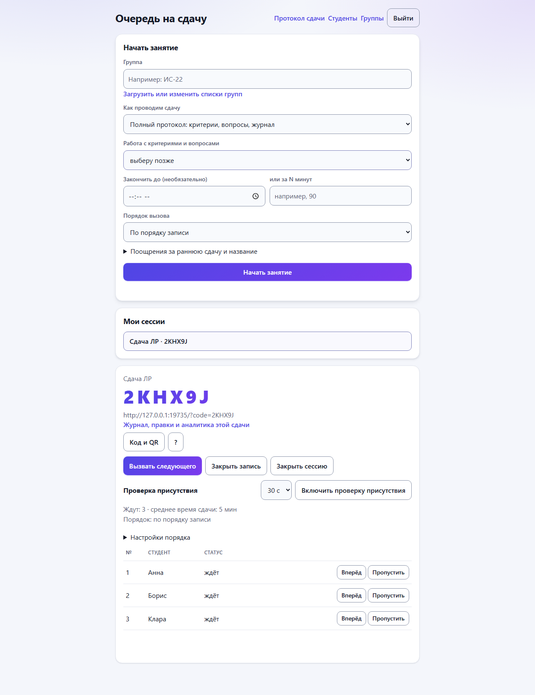
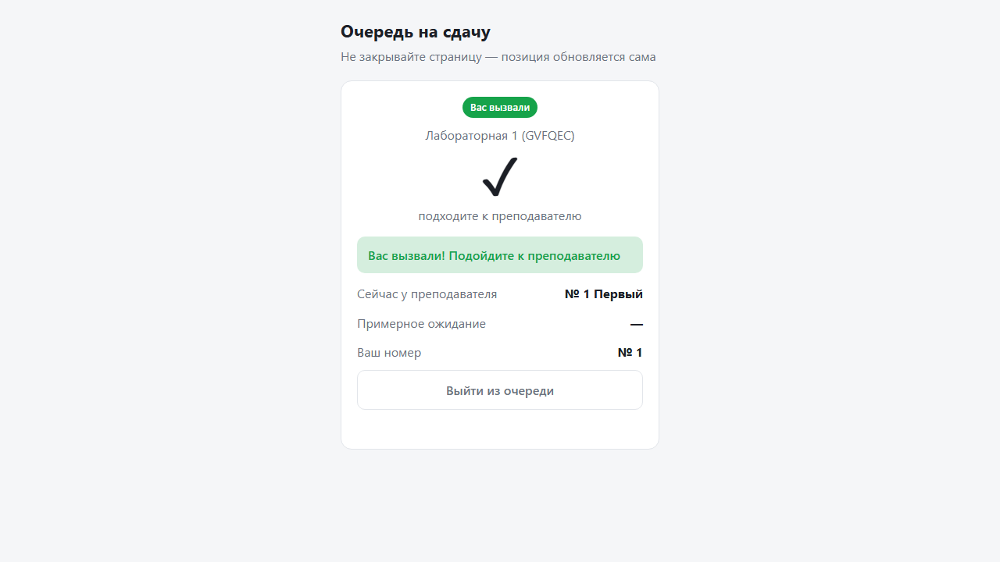
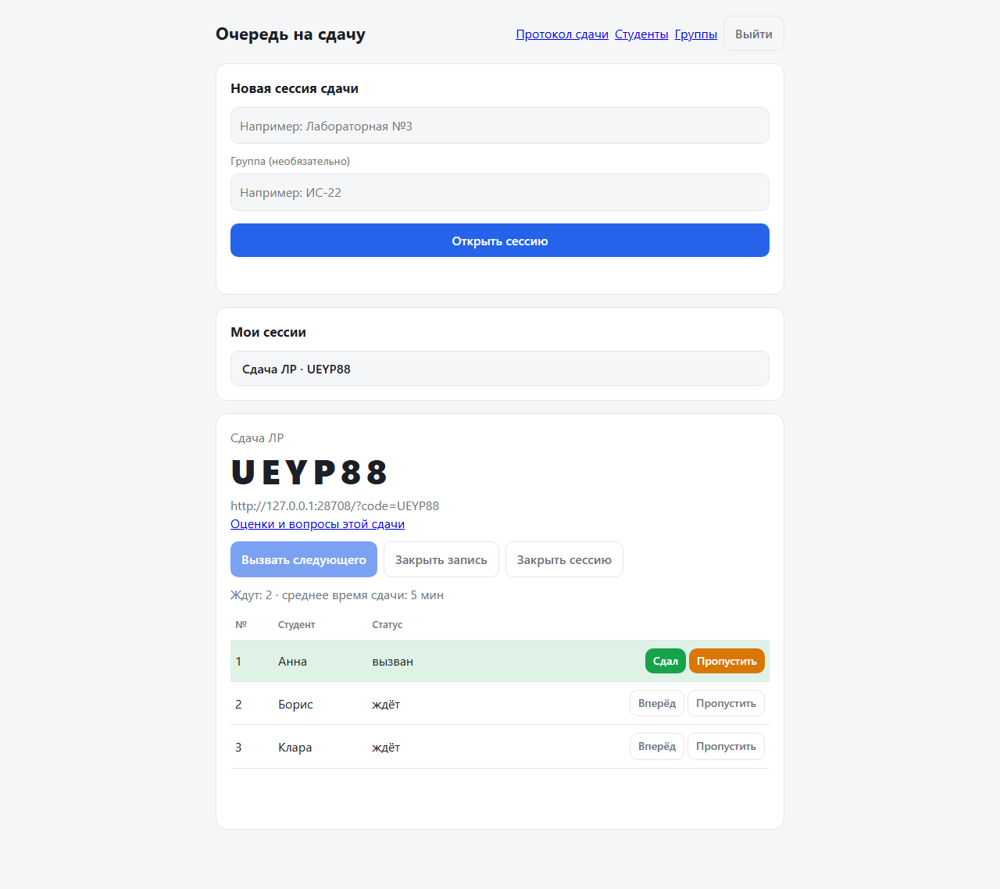
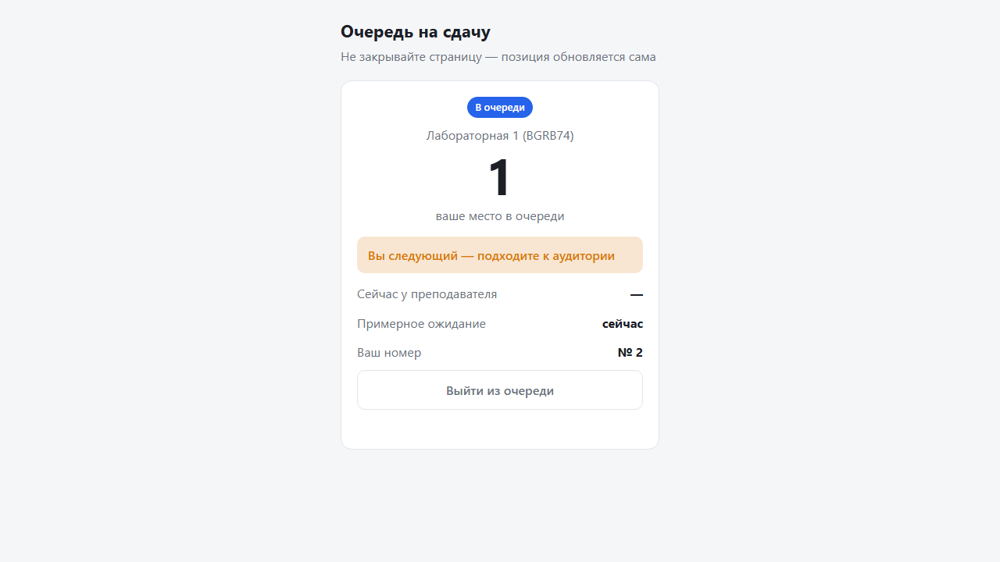
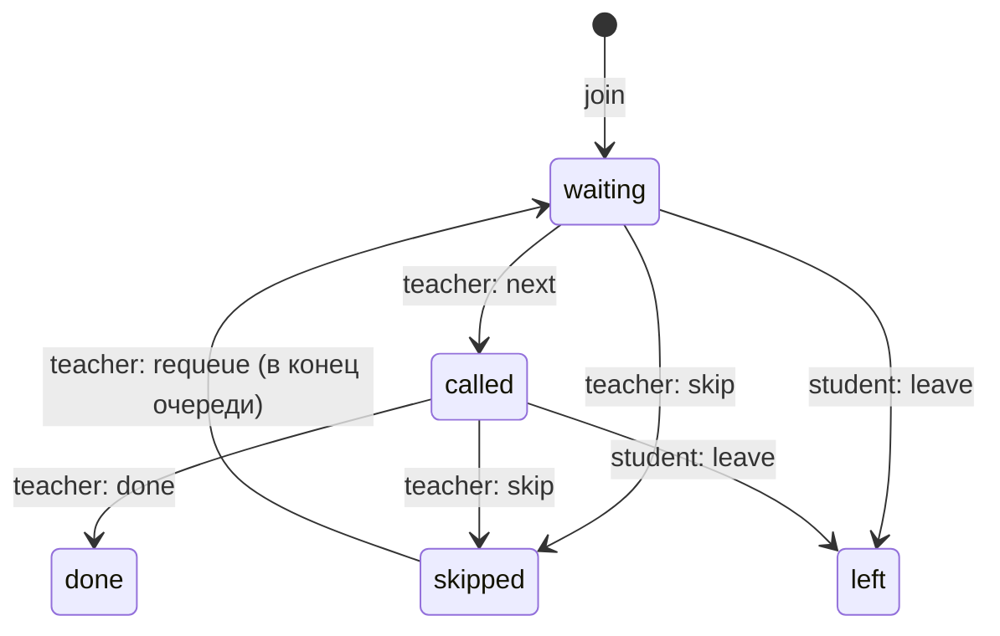

# Queue API: очередь на сдачу

Сервис для пары, на которой преподаватель принимает работы: преподаватель открывает сессию (с названием и необязательной группой), студенты заходят по коду и встают в очередь, видят свою позицию и примерное ожидание, преподаватель вызывает следующего. Страницы обновляются в реальном времени (SSE) с запасным опросом.

Стек: FastAPI, SQLAlchemy 2.0 (async), PostgreSQL 15, Alembic, pytest, Playwright, k6, Docker, GitHub Actions.

## Быстрый запуск

```bash
cp .env.example .env
# заполните DB_PASSWORD, JWT_SECRET_KEY, TEACHER_INVITE_CODE (подсказка в .env.example);
# с пустыми секретами и значениями change-me приложение не запустится
docker compose up -d --build
```

- Студенты: http://localhost:8000/ (можно по ссылке `/?code=ABC123`); тренировка: `/practice?code=ABC123` (если включена)
- Преподаватель: http://localhost:8000/teacher (регистрация требует `TEACHER_INVITE_CODE` из `.env`); работы, оценки и аналитика: `/protocol`
- Swagger: http://localhost:8000/docs
- Готовность: `GET /ready`, метрики: `GET /metrics`

Без Docker: поднять PostgreSQL, прописать `DATABASE_URL` в `.env`, затем `pip install -r requirements-dev.txt`, `alembic upgrade head`, `uvicorn main:app` (процесс один, см. «Ограничения»).

Развёртывание на сервере, HTTPS и резервные копии: [docs/DEPLOY.md](docs/DEPLOY.md).

## Скриншоты

| Преподаватель: очередь | Студент: вас вызвали |
|---|---|
|  |  |
|  |  |

## Как это работает

1. Преподаватель входит и создаёт сессию, получает код из 6 символов (без похожих `0/O`, `1/I`).
2. Студент вводит код и имя. Регистрации нет: браузер генерирует секретный токен, сервер хранит только его SHA-256 и по нему узнаёт студента. Токен лежит в `localStorage`, поэтому перезагрузка страницы запись не теряет.
3. Студент открывает поток SSE и сразу видит изменения места и времени. Если поток недоступен, страница каждые ~5 секунд опрашивает `GET /me`. Преподаватель смотрит очередь так же.
4. Преподаватель вызывает следующего, отмечает «сдал», пропускает, возвращает пропущенного или двигает студента вперёд.
5. Забытую сессию (нет активности дольше `SESSION_AUTO_CLOSE_HOURS`, по умолчанию 6) сервер закрывает сам.

### Состояния записи



`done` и `left` конечные. Опоздавший или вернувшийся студент встаёт заново с новым токеном.

### Номер и порядок

`ticket` (номер студента) выдаётся при входе и **никогда не меняется**. Порядок очереди задаёт отдельное поле `sort_order`: «вперёд» (`promote`) ставит студента на первое место среди ожидающих, `requeue` ставит пропущенного в конец. Места и ожидание считаются по `sort_order`. Из-за `requeue` в номерах могут быть пропуски.

### Время ожидания

`ожидание = (кто впереди + вызванный сейчас) × среднее время сдачи`. Среднее стартует с 5 минут и сглаживается по фактическому времени «вызвали → сдал» (экспоненциальное сглаживание 0,3, границы 30 с … 60 мин).

## Конкурентность и защита

| Риск | Решение |
|---|---|
| Двое входят одновременно, одинаковые номера | Номер выдаёт `UPDATE queue_sessions SET next_ticket = next_ticket + 1 RETURNING`, строка сессии блокируется на время вставки; плюс `UNIQUE(session_id, ticket)` |
| Двойное нажатие «Встать в очередь» | `UNIQUE(session_id, token_hash)`: повтор возвращает ту же запись, дубль не создаётся |
| Два параллельных «Вызвать следующего» или «Вперёд» | Операции преподавателя идут под `SELECT ... FOR UPDATE` на сессии; индексы «не больше одного `called`» и «уникальный `sort_order` среди ожидающих» страхуют на уровне БД |
| Очередь больше лимита при параллельных входах | `MAX_QUEUE_SIZE` и `MAX_ENTRIES_PER_SESSION` проверяются повторно после получения номера, под блокировкой |
| Чужая сессия или чужая запись | Все действия преподавателя проверяют владельца (404), запись ищется только внутри своей сессии |
| Перебор паролей | Лимит `login/register` с IP (20 в минуту по умолчанию) |
| Частые запросы | Лимиты по IP, по IP на `join` и по токену записи (`RATE_LIMIT_*`), ответ 429 с `Retry-After` |
| Перегрузка | Общий лимит одновременных запросов `MAX_CONCURRENT_REQUESTS` и таймаут пула соединений: мгновенный ответ 503 с `Retry-After` |
| Мусор в именах | Длина `NAME_MAX_LENGTH`, запрет управляющих символов; на страницах данные вставляются через `textContent` |
| Блокировка event loop | bcrypt выполняется в потоке (`asyncio.to_thread`), пул соединений настроен явно |
| Забытая открытая сессия | Фоновая задача закрывает сессии без активности дольше `SESSION_AUTO_CLOSE_HOURS` |
| Потоки SSE держат ресурсы | Потоки не держат соединения БД, рассылка из памяти одним снимком на сессию, лимит `SSE_MAX_PER_SESSION`, heartbeat, закрытие при остановке |

Гонки покрыты тестами с настоящей параллельностью (`asyncio.gather` по 10-300 запросов); для ключевых проверено мутацией, что тест падает без защиты (`docs/LEARNING.md`).

## API (`/api/v1`)

| Метод и путь | Кто | Что делает |
|---|---|---|
| `POST /auth/register`, `POST /auth/login`, `GET /auth/me` | преподаватель | аккаунт (по коду приглашения) и JWT |
| `POST /sessions`, `GET /sessions` | преподаватель | создать сессию (`title`, необязательная `group`), список своих |
| `GET /sessions/{code}` | все | название, группа, число ожидающих, кто сейчас вызван |
| `POST /sessions/{code}/join` | студент | встать в очередь (идемпотентно по токену) |
| `GET /sessions/{code}/me` | студент (`X-Entry-Token`) | статус, место, время, кто вызван |
| `GET /sessions/{code}/events` | студент (`X-Entry-Token`) | поток SSE: те же данные, что `/me`, по мере изменений |
| `POST /sessions/{code}/leave` | студент | выйти из очереди |
| `GET /sessions/{code}/queue` | преподаватель | активные записи |
| `GET /sessions/{code}/queue/events` | преподаватель | поток SSE очереди |
| `POST /sessions/{code}/next` | преподаватель | вызвать следующего |
| `POST /sessions/{code}/entries/{id}/done\|skip\|requeue\|promote` | преподаватель | сдал, пропустить, вернуть в конец, вперёд |
| `POST /sessions/{code}/close` | преподаватель | закрыть сессию |
| `POST/GET /assignments`, `GET/PATCH/DELETE /assignments/{id}` | преподаватель | работы (чужие дают 404) |
| `.../assignments/{id}/questions`, `.../criteria` | преподаватель | банк вопросов и критерии (критерии блокируются после первой сдачи) |
| `PUT /sessions/{code}/assignment` | преподаватель | подключить работу к сессии |
| `GET /sessions/{code}/submissions[/current]`, `GET /submissions/{id}` | преподаватель | сдачи сессии, вопросы, баллы |
| `PUT /submissions/{id}/grades`, `POST .../complete`, `POST .../correct`, `GET .../audit` | преподаватель | черновик оценок, завершение, правка с причиной, журнал |
| `GET /sessions/{code}/me/submission` | студент (`X-Entry-Token`) | свои вопросы и разбивка баллов после завершения |
| `POST /assignments/{id}/ai/draft`, `GET /ai/jobs/{id}`, `POST /ai/jobs/{id}/approve`, `GET /ai/status` | преподаватель | черновик банка от модели (фоновая задача), утверждение |
| `GET /practice/{code}`, `POST /practice/{code}/check`, `GET /practice/{code}/jobs/{id}` | студент | тренировка (не оценка) |
| `GET /assignments/{id}/analytics`, `GET /sessions/{code}/analytics` | преподаватель | агрегаты и выбросы по длительности |
| `GET /health`, `GET /ready`, `GET /metrics` | все | жив ли процесс; готов ли (БД и миграции); счётчики |

Любая ошибка имеет вид `{"detail": "...", "code": "queue_empty", "request_id": "..."}` (для 422 добавлен список `errors`). В каждом ответе есть заголовок `X-Request-ID`.

## Тесты и качество

```bash
pip install -r requirements-dev.txt
pytest --cov                              # API, гонки, SSE, лимиты, миграции (без браузера)
python -m playwright install chromium     # один раз
pytest -m e2e --no-cov                    # страницы в настоящем браузере, отдельным запуском
ruff check . && ruff format --check . && mypy
alembic upgrade head && alembic check
```

Тестовая база `queue_test` и база e2e `queue_e2e` создаются автоматически рядом с основной. e2e запускаются отдельно, потому что sync Playwright держит event loop процесса. CI (`.github/workflows/ci.yml`) делает всё это на PostgreSQL, версии actions закреплены по SHA. Скриншоты ключевых состояний: `docs/screenshots/`. Актуальные числа: раздел «Итоги проверки».

**Стабильность e2e.** На Python 3.11 (Windows) e2e стабильны: 5 полных прогонов из 5 прошли (по 35 passed). На Python 3.14 под Windows иногда происходит сбой интерпретатора: процесс тестового сервера завершается с кодом `0xC0000005`, и оставшиеся тесты падают с `ConnectError` (4 из 11 полных прогонов, причина не найдена, см. `docs/KNOWN_ISSUES.md`, п. 19). Для e2e используйте Python 3.11, как в Docker и CI.

## Нагрузочный тест

Сценарии (k6 в Docker, внутри сети Docker):

- **пик**: 300 студентов входят за 60 секунд, потом опрашивают позицию каждые 5 секунд, преподаватель вызывает следующего раз в минуту;
- **залп**: 300 входов за 5 секунд;
- **SSE**: то же вместо опроса (`loadtest/sse_peak.py`, k6 не держит потоки).

```bash
docker compose up -d postgres
bash loadtest/one_run.sh peak new my-run      # peak|salvo|sse|ssesalvo, base|new, метка
python loadtest/summarize.py                  # медиана и разброс по повторам
```

Результаты, методика, плохие прогоны и ограничения: [docs/LOADTEST.md](docs/LOADTEST.md).

**Что измерено.** Серии по 3 повтора на двух кодовых базах («база» и «новый» код) для сценариев пика и залпа плюс SSE-прогоны. На пике новый код по медианам не хуже базы, на залпе (300 входов за 5 с) не быстрее; один из SSE-залпов дал p95 входа 31 с и отказы, два других нормальные. Подробные таблицы с разбросом: [docs/LOADTEST.md](docs/LOADTEST.md).

**Оговорки.** Замеры шумные: ноутбук, во время серий работали браузер, IDE, антивирус и игровой клиент (свободной памяти было 0,52 из 15,79 ГБ), k6 и приложение делят процессор. Это не оценка для продакшена. Правка входа в очередь (`join`), сделанная после серий, покрыта тестами, но её влияние на нагрузку **не измерено**. Измерения будут повторены на тихой машине: команда и условия в разделе «Что повторить» в `docs/LOADTEST.md`.

## Протокол сдачи, ИИ-помощник, аналитика

Идея: прозрачные правила сдачи. **Оценивает всегда человек**, модель ничего не оценивает. Проект и решения: [docs/PROTOCOL_DESIGN.md](docs/PROTOCOL_DESIGN.md), [docs/DECISIONS.md](docs/DECISIONS.md) п. 15-23.

- **Протокол** (страница `/protocol`). Преподаватель создаёт работу, критерии (название, максимум баллов) и банк вопросов (сложность, тема), подключает работу к сессии. При вызове студента система случайно выбирает N вопросов (по умолчанию 3, без повторов), сохраняя зерно выбора для аудита. Во время сдачи на странице идёт таймер (подсказка, не блокировка), преподаватель ставит баллы по критериям и комментарий и завершает сдачу. Любая правка после завершения требует причину и пишется в неизменяемый журнал (было, стало, кто, когда; запрет `UPDATE`/`DELETE` в БД триггером). Студент без аккаунта видит после завершения только **свои** вопросы и разбивку баллов. Критерии нельзя менять после первой сдачи.
- **ИИ-черновик банка** (необязательно, `AI_ENABLED=true`). Локальная модель через Ollama предлагает 10-15 вопросов и критерии по тексту работы; это черновик, который преподаватель проверяет, правит и утверждает. Генерация фоновая (состояния «в очереди, идёт, готово, ошибка»), в модель уходит только текст работы. Установка и ограничения: [docs/AI.md](docs/AI.md).
- **Тренировка** (страница `/practice`, включается преподавателем). Студент отвечает на вопрос из банка, модель говорит, верно ли и что повторить; «тренировка, не официальная оценка», ответы не сохраняются и не влияют на оценки. Без модели показывается самопроверка по критериям.
- **Аналитика справедливости** (только преподавателю, на `/protocol`). Сколько сдач, медиана и разброс длительности, распределение баллов по критериям, выбросы по длительности относительно медианы **той же группы результата**; только номера талонов, текст по шаблону. При менее чем 5 сдачах выводов нет (порог `ANALYTICS_MIN_SUBMISSIONS`).

Ограничения: один процесс (задачи модели, лимиты тренировки и SSE в памяти); модель на процессоре медленная (на нагруженном ноутбуке 56-206 с на черновик и около 40-50 с на проверку ответа, 12.11.2026, один замер, см. `docs/AI.md`); на VPS с 1 ГБ памяти модель не запускается, нужен более сильный сервер или облачный API; тренировка раскрывает банк вопросов, поэтому выключена по умолчанию; проверено на одной модели (`qwen3.5:9b`) и одной теме: формат запроса работает, вопросы по теме, но бывают фактические огрехи и неполные черновики; другие темы, тихая машина и Linux не проверены.

## Документы

- [docs/PROTOCOL_DESIGN.md](docs/PROTOCOL_DESIGN.md): проект протокола сдачи.
- [docs/AI.md](docs/AI.md): ИИ-помощник (Ollama, настройки, ограничения).
- [docs/DECISIONS.md](docs/DECISIONS.md): решения, принятые без владельца (нужно подтвердить).
- [docs/KNOWN_ISSUES.md](docs/KNOWN_ISSUES.md): что не удалось.
- [docs/PROGRESS.md](docs/PROGRESS.md): журнал работ.
- [docs/FINAL_REPORT.md](docs/FINAL_REPORT.md): итоговый отчёт.

## Ограничения

- **Один процесс:** рассылка SSE, лимиты частоты и метрики хранятся в памяти процесса. Для нескольких процессов нужен Redis или `LISTEN/NOTIFY` (не реализовано).
- Значения лимитов (`MAX_CONCURRENT_REQUESTS`, `RATE_LIMIT_*`, `SESSION_AUTO_CLOSE_HOURS`) подобраны по ограниченным измерениям и допущениям, пилот на настоящей группе их проверит.
- Деплой на сервер, мониторинг, внешние резервные копии не проверялись.
- Требований с числами от колледжа нет, критерии в нагрузочном тесте мои допущения.

## Структура

```
main.py            приложение, обработчики ошибок, /health /ready /metrics, страницы
routers/           HTTP-слой (sessions, auth, live, protocol, ai, practice, analytics)
services/          бизнес-логика очереди, протокол, SSE-хаб, провайдер ИИ, тренировка, аналитика, автозакрытие, авторизация
repositories/      запросы к БД
models/ schemas/   ORM-модели и Pydantic-схемы
core/              настройки, безопасность, лимиты, метрики, request id, исключения
alembic/           миграции (sort_order, group_name, протокол, ai_jobs)
static/            страницы студента, преподавателя, протокола и тренировки
tests/             pytest (гонки, SSE, лимиты, миграции), tests/e2e: браузер
loadtest/          k6, SSE-клиент, скрипты прогонов и сводка
docs/              LEARNING, LOADTEST, DEPLOY, DECISIONS, отчёты, скриншоты
```

## Итоги проверки (локальный прогон)

Локальный прогон 11.11 (Python 3.14, PostgreSQL в Docker), после добавления протокола, ИИ-части, тренировки и аналитики:

- `pytest --cov`: **196 тестов прошли, 1 пропущен** (необязательный интеграционный тест с настоящей Ollama, `RUN_OLLAMA_TESTS=1`), покрытие **95%** (2680 строк, 134 не покрыто);
- `pytest -m e2e --no-cov`: **33 теста** в браузере прошли (из них 7 для протокола, ИИ-черновика, тренировки и аналитики);
- `ruff check .`, `ruff format --check .` (86 файлов), `mypy` (51 файл): без замечаний;
- `alembic upgrade head`, `alembic check`: без замечаний; на временной базе проверены `upgrade`, `downgrade` на одну ревизию и `upgrade` снова;
- мутации (убрали защиту, тест упал): блокировка сессии при правке оценок (падает тест цепочки журнала), запрет правки критериев после первой сдачи, выбор вопросов с повторами (6 тестов), ответ студента в системном сообщении, отсутствие валидации вывода модели (8 тестов); из прежних: шлюз `join`, `WHERE` в `insert_entry_if_room`;
- Docker: `docker compose build --no-cache web`, запуск, `/ready` 200, `/`, `/teacher`, `/protocol`, `/practice` отдают 200.
